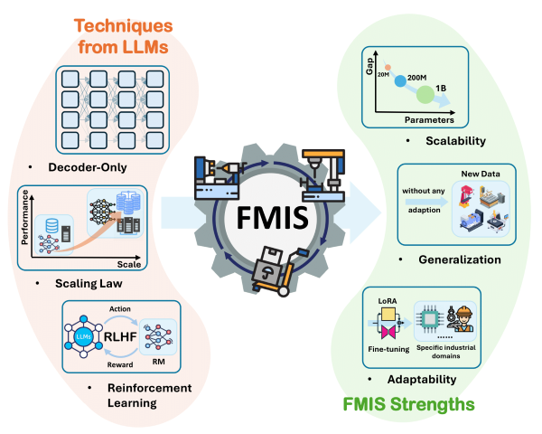
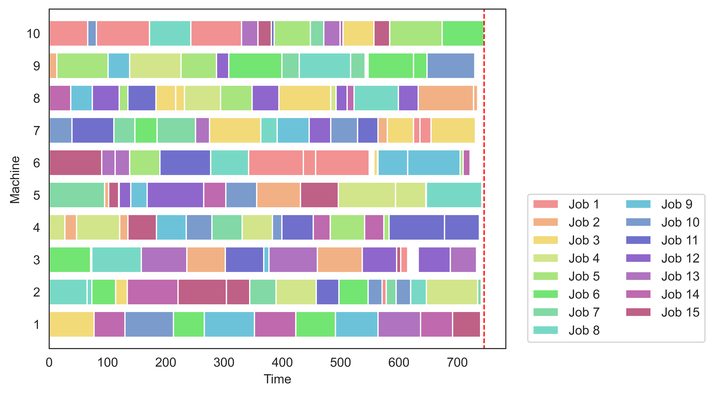

# Foundation Models for Industrial Scheduling



## Overview

This repository provides the official research implementation of **Foundation Models for Industrial Scheduling**, a framework that adapts key architectural and training principles from Large Language Models (LLMs) to large-scale industrial scheduling problems.

We propose a **transformer-based foundation model** trained via large-scale reinforcement learning. By leveraging representation sharing, scalable training, and knowledge distillation, the proposed approach demonstrates strong **generalization, adaptability, and transferability** across diverse scheduling environments—properties that are difficult to achieve with classical heuristics or instance-specific learning methods.

The framework is primarily evaluated on **Flexible Job Shop Scheduling Problems (FJSP)** and consistently outperforms established baseline approaches.

------

## Problem Setting

We consider large-scale **industrial scheduling problems**, with a focus on **Flexible Job Shop Scheduling (FJSP)**. Each problem instance consists of:

- A set of jobs, each composed of multiple operations
- A set of machines with heterogeneous processing capabilities
- Precedence constraints between operations
- Resource and energy constraints on machine usage

The objective is to learn a **general-purpose scheduling policy** that minimizes the makespan and other real-world objectives and generalizes across different problem sizes, job distributions, and machine configurations.

------

## Method Overview

Our approach follows the **foundation model paradigm**, characterized by:

- A unified transformer-based architecture shared across scheduling instances
- Training on a broad distribution of synthetic scheduling environments
- Strong generalization across unseen instances without retraining
- Adaptability to different problem scales and configurations

The model is trained using large-scale reinforcement learning and can be distilled into compact models for efficient evaluation and deployment.

------

## Key Features

- Transformer-based foundation model for industrial scheduling
- Scalable multi-GPU training with distributed PPO
- Strong zero-shot and transfer generalization
- Knowledge distillation from large teacher models
- Compatibility with standard scheduling benchmarks

------

## Repository Structure

This repository includes:

- End-to-end training and evaluation pipelines
- Pretrained distilled checkpoints
- Benchmark datasets and visualization utilities
- Scripts supporting reproducibility and analysis

------

## Requirements

- Python ≥ 3.10
- PyTorch ≥ 2.4.0
- accelerate ≥ 0.32.1
- numpy
- matplotlib
- seaborn
- tqdm

------

## Quick Start

### Evaluation

Evaluate a pretrained distilled model on an FJSP benchmark instance:

```
python test.py \
  --actor_path models/Distillate4Demo/actor.pth \
  --critic_path models/Distillate4Demo/critic.pth \
  --FJSPpath data/HurinkBenchmark/HurinkVdata25.fjs \
  --num_beams 32 \
  --GANTTsavepath results/Gantt.png
```

**Expected output:**

```
Makespan: 748
```



> **Note**
>  Job indices are randomly permuted in the current implementation, which may result in minor variability across runs.

------

### Training

Large-scale training is performed using **distributed PPO** with the `accelerate` framework:

```
accelerate launch \
  --multi_gpu \
  --mixed_precision=bf16 \
  --num_processes=8 \
  Train.py \
  --n 10 \
  --m 10 \
  --h 10 \
  --n_epoch 80000 \
  --batch_size_envs 32 \
  --batch_size_ppo 256 \
  --beta 0.01 \
  --config_actor_deep 8 \
  --config_actor_dim 1024 \
  --config_actor_mlp_ratio 4 \
  --config_critic_deep 8 \
  --config_critic_dim 1024 \
  --config_critic_mlp_ratio 4
```

**Training Notes**

- Adjust `num_processes` and batch sizes according to available computational resources.
- Learning rate tuning is recommended when changing parallelism or batch configurations, as training dynamics are sensitive to these parameters.

------

## Pretrained Models and Distillation

To support reproducibility and practical evaluation, we apply **knowledge distillation** to compress the full-scale foundation model into a compact student model while preserving most of its scheduling capability.

- **Teacher model**: XXL foundation model (~2B parameters)
- **Student model**: *Distillate4Demo* (~60M parameters)
- **Training scale**: $10 \times 10$ FJSP instances

Although the distilled model exhibits slightly reduced performance compared to the teacher model, it significantly outperforms classical heuristics and learning-based baselines.

### Distilled Model Configuration

```
config_actor = {
    "deep": 4,
    "dim": 512,
    "n_head": 16,
    "mlp_ratio": 2,
}

config_critic = {
    "deep": 4,
    "dim": 512,
    "n_head": 16,
    "mlp_ratio": 2,
}
```

------

## Evaluation Protocol

- Models are evaluated on held-out FJSP instances
- Beam search is applied during inference to improve solution quality
- The primary evaluation metric is **makespan**

------

## Reproducibility

- Most experimental results (except for those involving actual factory data) reported in the accompanying paper can be reproduced using this repository
- Pretrained distilled checkpoints are provided for direct evaluation
- Training configurations are explicitly documented
- Random seeds can be fixed via command-line arguments

------

## Limitations and Future Directions

- Lack of visualization tools (only Gantt-based analysis now)
- Scalability to very large numbers of machines remains an open challenge

------

## License

This project is released under the **MIT License**.

The MIT License is a permissive open-source license widely used in the machine learning research community, including ICML, NeurIPS, and ICLR projects. It allows reuse, modification, and distribution of the code with minimal restrictions.

See the `LICENSE` file for full license text.

------

> **Disclaimer**
